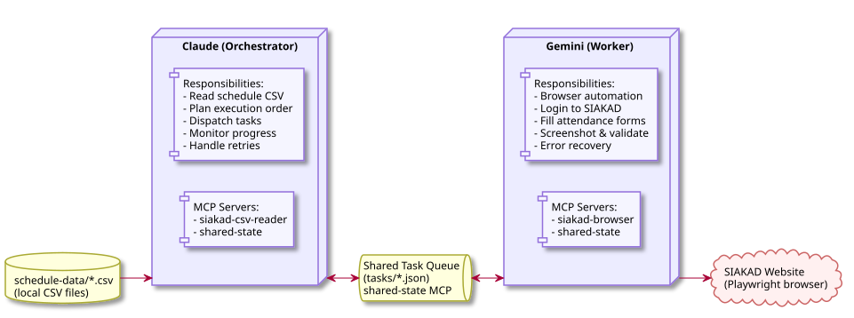
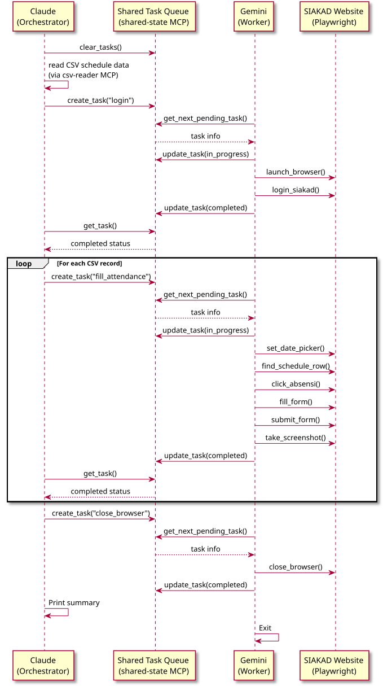

# SIAKAD attendance filler with two AI agents

Code for session 14 (Multi-Agent Software Systems) of IT30213 Advanced Software Engineering & DevOps. It fills in the Berita Acara Perkuliahan, the lecture attendance report, on [SIAKAD Pradita University](https://siakad.pradita.ac.id). For every lecture you list in a schedule file, it logs in, opens the attendance page, finds the class on that date, and types in the topic and the description. Two AI agents share the work. Claude Code, the orchestrator, reads the schedule and writes one task per lecture into a task queue. Gemini CLI, the browser worker, then works through the queue in a real browser window. The agents reach the schedule, the queue and the browser through three MCP servers written in Python.

The full run works on the real SIAKAD with your own account: it logs in with your password and saves attendance reports. Steps 1 to 5 stay on your machine and change nothing on SIAKAD. Try the full run with a schedule of one lecture first (step 6).

## How the pieces fit together

```
Phase 1  claude -p --[siakad-csv-reader]--> schedule-data/*.csv
                   --[shared-state]-------> tasks/task_001.json ... tasks/task_NNN.json

Phase 2  gemini    --[shared-state]-------> tasks/*.json, one task after the other
                   --[siakad-browser]-----> Chromium window --> https://siakad.pradita.ac.id
```

`run_multiagents.sh` runs the two phases one after the other. Claude runs first, creates all tasks and exits: `task_001` logs in, one `fill_attendance` task follows per lecture, and the last task closes the browser. Gemini then reads all tasks in order and works through them. The agents never talk to each other directly. The only thing they share is the folder `tasks/`, with one JSON file per task, which the shared-state server reads and writes for both.





An MCP server is a small program that an AI agent starts and talks to over stdin and stdout, using the Model Context Protocol. Each server offers tools, which the agent calls with arguments:

| Server | Launcher | Tools | What it does |
|---|---|---|---|
| `siakad-csv-reader` | `mcp-servers/csv-reader/run.sh` | 4: `list_schedule_files`, `read_attendance_data`, `get_attendance_for_date`, `list_attendance_dates` | Reads the CSV and Excel files in `schedule-data/`, accepts several spellings of the column names, and returns every date as `YYYY-MM-DD`. |
| `shared-state` | `agents/run_shared_state.sh` | 7: `create_task`, `get_task`, `update_task`, `list_tasks`, `get_next_pending_task`, `get_all_tasks_ordered`, `clear_tasks` | The task queue: one JSON file per task in `tasks/`, with a status that goes from `pending` to `in_progress` to `completed` or `failed`. |
| `siakad-browser` | `mcp-servers/browser-automation/run.sh` | 17: `launch_browser`, `login_siakad`, `navigate_to_daftar_hadir`, `set_semester`, `set_date_picker`, `get_schedule_list`, `find_schedule_row`, `click_absensi_button`, `fill_attendance_form`, `submit_attendance_form`, `take_screenshot` and six helpers | Drives a visible Chromium window with Playwright. It reads the SIAKAD addresses and your login from `config.json`. |

The four start scripts combine the agents and servers differently:

| Script | Agents | MCP servers | You take part |
|---|---|---|---|
| `run_multiagents.sh` | Claude (orchestrator), then Gemini (worker) | Claude: CSV reader and task queue. Gemini: browser and task queue. | no |
| `run_claude_only.sh` | Claude does everything | all three | no |
| `run_gemini_only.sh` | Gemini does everything | browser and CSV reader | no |
| `run_claude_interactive.sh` | Claude in chat mode | all three | yes, you guide it step by step |

```
config.example.json                 the SIAKAD addresses and a placeholder login; copy it to config.json
config.json                         your own copy with your login (Git ignores it)
requirements.txt                    the Python packages of the three servers
schedule-data/                      one schedule file per course (CSV or Excel)
mcp-servers/csv-reader/             server.py and run.sh of siakad-csv-reader
mcp-servers/browser-automation/     server.py and run.sh of siakad-browser
agents/shared_state.py              the shared-state server, started by agents/run_shared_state.sh
agents/orchestrator_prompt.md       Claude's instructions in the multi-agent mode
agents/worker_prompt.md             Gemini's instructions in the multi-agent mode
CLAUDE.md, GEMINI.md                short instructions that each CLI reads when it starts in this folder
.claude/settings.json, .gemini/settings.json   MCP settings for the CLIs (see step 6)
run_multiagents.sh, run_claude_only.sh, run_gemini_only.sh, run_claude_interactive.sh   the four modes
check_mcp_servers.py                starts the three servers and checks them without SIAKAD (step 5)
tasks/                              the task queue, created at run time (Git ignores it)
figures/                            the two diagrams above, as Mermaid, PlantUML, SVG and PDF
```

## Before you start

- Python 3.10 or newer and the virtual environment in `projects/.venv`, one folder up from this README. `python3 --version` should print a version number. This guide was tested with Python 3.12.3. If you don't have the environment yet, create it from this folder:

  ```bash
  python3 -m venv ../.venv
  ```

  On Ubuntu, if `python3 -m venv` fails, run `sudo apt install python3-venv` first.
- Node.js 18 or newer with npm, for the two CLIs. `node --version` should print a version number. Tested with Node.js 22.23.4.
- Claude Code, the Claude CLI. Install it with `npm install -g @anthropic-ai/claude-code`, then run `claude` once and log in with a Claude account or an Anthropic API key. `claude --version` should print a version number. Tested with 2.1.328.
- Gemini CLI. Install it with `npm install -g @google/gemini-cli`, then run `gemini` once and log in with your Google account. `gemini --version` should print a version number. Tested with 0.40.1.
- A desktop session. The browser server opens a visible Chromium window on the X display `:0`, so that you can watch it work.
- A lecturer account on SIAKAD, for step 6 and later.
- Internet access and about 1 GB of disk space. pip downloads the packages, and Playwright downloads Chromium, which takes about 700 MB once it is unpacked.

## Step 1. Go to the project folder

```bash
cd projects/session-14
```

Run every command in this guide from this folder.

## Step 2. Install the Python packages and Chromium

```bash
../.venv/bin/pip install -r requirements.txt
../.venv/bin/playwright install chromium
```

```
Successfully installed ... mcp-1.30.0 ... openpyxl-3.1.5 pandas-3.1.1 ... playwright-1.65.2 ...
```

`requirements.txt` keeps `mcp` below version 2. The servers use FastMCP from the 1.x SDK, and mcp 2.0 renamed that API, so with mcp 2 every server stops at once with `No module named 'mcp.server.fastmcp'`.

The three launchers start the servers with `../.venv/bin/python`, seen from this folder. To use another Python, set the variable `SIAKAD_PYTHON` to its path before you start an agent.

## Step 3. Put your login into `config.json`

```bash
cp config.example.json config.json
```

Open `config.json` and replace `username` and `password` with your SIAKAD login:

```json
{
  "siakad": {
    "login_url": "https://siakad.pradita.ac.id/login",
    "daftar_hadir_url": "https://siakad.pradita.ac.id/dosen/daftar_hadir",
    "username": "your.email@pradita.ac.id",
    "password": "your_password"
  },
  "schedule_dir": "./schedule-data"
}
```

The browser server reads this file when it starts, and `login_siakad` uses the login unless an agent passes another one. Git ignores `config.json`, so your password stays on your machine. Never commit it: a password that was ever pushed stays in the history of the repository, and a public repository shows it to everyone.

## Step 4. Write the schedule

Put one CSV or Excel file per course into `schedule-data/`. Use lowercase letters and underscores in the file name, such as `advanced_software_engineering_and_devops.csv`. The example file has the 15 sessions of this course:

```
no,semester,tanggal,mata_kuliah,kelompok_kelas,topik,deskripsi
1,2025/2026 GENAP,2026-01-21,Advanced Software Engineering & DevOps,-,Session-01: General Lecture,"Overview of course objectives, ..."
2,2025/2026 GENAP,2026-01-28,Advanced Software Engineering & DevOps,-,Session-02: Docker-based Software System,"Building and demonstrating ..."
```

| Column | Required | Meaning |
|---|---|---|
| `no` | no | Number of the session, only for you. |
| `semester` | no | The semester as SIAKAD shows it, such as `2025/2026 GENAP`. |
| `tanggal` | yes | Date of the lecture, as `YYYY-MM-DD` or `DD/MM/YYYY`. |
| `mata_kuliah` | yes | Name of the course, exactly as SIAKAD shows it. |
| `kelompok_kelas` | no | The class group, such as `Kelas A`. `-` or an empty cell means the course has one group. |
| `topik` | yes | The topic to fill in. |
| `deskripsi` | yes | The description to fill in. |

The CSV reader also accepts `date`, `course`, `kelas`, `topic` and `description` as column names. If you teach the same course to two groups on one date, write one row per group.

## Step 5. Check the MCP servers without SIAKAD

`check_mcp_servers.py` starts each server through its launcher and talks to it over stdio, as the agents do. It reads the schedule with the CSV reader, and creates, updates and deletes two tasks in the queue. It does not open the browser, and it does not contact SIAKAD.

```bash
../.venv/bin/python check_mcp_servers.py
```

```
siakad-csv-reader: 4 tools
  read_attendance_data, list_schedule_files, get_attendance_for_date, list_attendance_dates
  advanced_software_engineering_and_devops.csv: 15 records
    2026-01-21  Session-01: General Lecture
    2026-01-28  Session-02: Docker-based Software System
    2026-02-04  Session-03: Observability in Software Systems
    ...
shared-state: 7 tools
  create_task, get_task, update_task, list_tasks, get_next_pending_task, get_all_tasks_ordered, clear_tasks
  Cleared 0 task(s).
  Task 'task_001' created with type 'login' and status 'pending'.
  Task 'task_002' created with type 'close_browser' and status 'pending'.
  Task 'task_001' updated to status 'completed'.
  next pending task: task_002 (close_browser)
  Cleared 2 task(s).
siakad-browser: 17 tools
  launch_browser, login_siakad, navigate_to_daftar_hadir, set_date_picker, set_semester, click_search_or_filter, get_schedule_list, find_schedule_row, click_absensi_button, fill_attendance_form, submit_attendance_form, take_screenshot, get_page_html, run_js, click_element, fill_input, close_browser
```

The lines that start with `INFO:mcp.server.lowlevel.server` come from the servers themselves, one per request. To check another schedule file, pass its path: `../.venv/bin/python check_mcp_servers.py schedule-data/<file>.csv`. Each date must come out as you meant it, because that is the date the agents will open on SIAKAD.

## Step 6. Run the two agents

Start with a schedule of one lecture, so that a mistake costs one form. Put a copy of your CSV with only the header and one row into its own folder, and pass the folder to the script:

```bash
mkdir -p ~/siakad-one
head -2 schedule-data/advanced_software_engineering_and_devops.csv > ~/siakad-one/test.csv
./run_multiagents.sh ~/siakad-one
```

Without an argument the script uses `schedule_dir` from `config.json`, which is `schedule-data/`. It then:

1. deletes the old tasks in `tasks/`, prints the schedule folder and the files it found;
2. writes `.gemini/settings.json`, which gives Gemini the browser server and the task queue;
3. starts Claude with `claude -p`, its instructions from `agents/orchestrator_prompt.md`, and a temporary MCP configuration (`--mcp-config`) with the CSV reader and the task queue. `--dangerously-skip-permissions` lets Claude call these tools without asking you. Claude reads the schedule, creates the tasks and exits, and the script prints `Phase 1 complete: N task(s) created.` For one lecture the prompt asks for 3 tasks: login, the lecture, and closing the browser;
4. starts Gemini with `gemini --yolo --model gemini-3-flash-preview --prompt ...`, its instructions from `agents/worker_prompt.md`. `--yolo` lets Gemini call the tools without asking. A Chromium window opens on the left of the screen. Gemini logs in, opens the attendance page, chooses the semester and the date, finds the row of the course, opens its form, types the topic and the description, saves, and checks for SIAKAD's message `Sukses update topik pembahasan`;
5. prints `Done. All agents finished.`

Gemini's prompt asks it to explain each step before it calls a tool, so its output is a log of the run. Check the result on SIAKAD itself, and look at the tasks:

```bash
cat tasks/*.json
```

Each task ends as `completed` or `failed`, with a `result` or an `error`. When a tool fails, the browser server saves a screenshot to `/tmp`, for example `/tmp/siakad_absensi_debug.png`, and `take_screenshot` saves there as well.

## Step 7. The other modes

```bash
./run_claude_only.sh ~/siakad-one
./run_gemini_only.sh ~/siakad-one
./run_claude_interactive.sh ~/siakad-one
```

In the two single-agent modes one agent reads the schedule and drives the browser, without a task queue. The interactive mode starts Claude in chat mode with all three servers and a first prompt. Then you guide it, for example:

```
> List all schedule files
> Launch the browser and log in
> Fill the attendance for 2026-01-21
> Take a screenshot
```

Chapter 14 compares the modes: the split into an orchestrator and a worker keeps each agent's instructions and context small, at the price of two CLIs and a queue.

## Changing the settings

| Setting | Where | Meaning |
|---|---|---|
| `username`, `password` | `config.json` | Your SIAKAD login. |
| `login_url`, `daftar_hadir_url` | `config.json` | The SIAKAD pages the browser server opens. |
| `schedule_dir` | `config.json` | The schedule folder that the scripts use when you give them no folder. |
| schedule folder | first argument of each `run_*.sh` | Overrides `schedule_dir` for one run. |
| `--model gemini-3-flash-preview` | `run_multiagents.sh`, `run_gemini_only.sh` | The Gemini model. The comment above the command lists others. |
| `DISPLAY` | `.claude/settings.json`, `.gemini/settings.json` and the `run_*.sh` scripts | The X display on which the browser window opens. |
| `SIAKAD_PYTHON` | environment variable | The Python the three launchers start, instead of `../.venv/bin/python`. |
| `agents/*.md` | prompt files | What the orchestrator and the worker are told to do. |

The scripts give the CLIs their MCP servers themselves: Claude through a temporary file passed with `--mcp-config`, and Gemini through `.gemini/settings.json`, which `run_multiagents.sh` and `run_gemini_only.sh` write before they start Gemini. `.claude/settings.json` lists the three servers as well, but the scripts do not rely on it.

## Troubleshooting

| Problem | What to do |
|---|---|
| `No module named 'mcp.server.fastmcp'` | mcp 2.x is installed. Run the `pip install -r requirements.txt` command from step 2 again, which installs mcp 1.30.0. |
| `No module named 'mcp'`, `'pandas'` or `'playwright'` | The packages are not in the Python the launchers start. Do step 2, or point `SIAKAD_PYTHON` at the Python that has them. |
| `.../.venv/bin/python: No such file or directory` | The environment `projects/.venv` does not exist. Create it as described in "Before you start". |
| `Permission denied` when a script or launcher starts | The executable bit got lost, for example when the folder was copied from Windows. Run `chmod +x run_*.sh mcp-servers/*/run.sh agents/run_shared_state.sh`. |
| `FileNotFoundError: ... config.json` | Do step 3. The browser server stops without that file. |
| `Executable doesn't exist at .../chromium...` | Run `../.venv/bin/playwright install chromium`. |
| Chromium does not start, with `Missing X server or $DISPLAY` | Run the scripts in a desktop session, and set `DISPLAY` to its display (see "Changing the settings"). |
| Chromium does not start, with a message about missing libraries | Install them with `sudo ../.venv/bin/playwright install-deps chromium`. |
| `Error: Claude orchestrator failed`, or `No tasks were created` | Read Claude's output above the message. `claude` must be logged in (run it once without arguments), and step 5 must work. |
| Gemini has no `siakad-browser` or `shared-state` tools | Start `gemini` once in this folder and type `/mcp`. It lists the servers from `.gemini/settings.json` and whether they started. Run step 5 to see a launcher's error. |
| A task stays `in_progress` | The worker stopped in the middle. Start the script again: it deletes the old tasks first. |
| The agent cannot find a field or a button | SIAKAD's page changed. Ask the agent, for example in the interactive mode, to call `take_screenshot` and `get_page_html`, then to use `click_element` and `fill_input` with the selectors it finds. |
| The wrong date opens on SIAKAD | Check the dates with step 5. Write them as `YYYY-MM-DD` or `DD/MM/YYYY`. A value such as `02/04/2026` is read as 2 April. |
